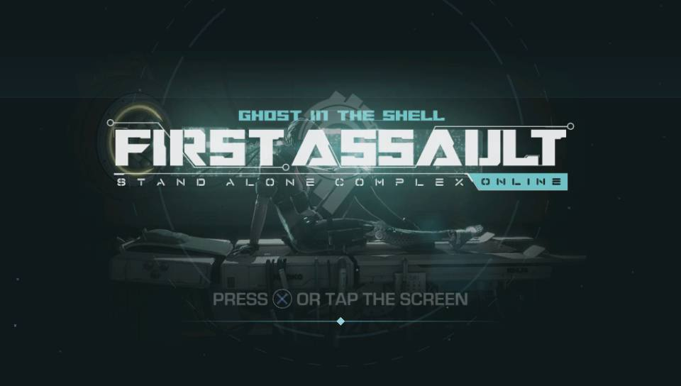
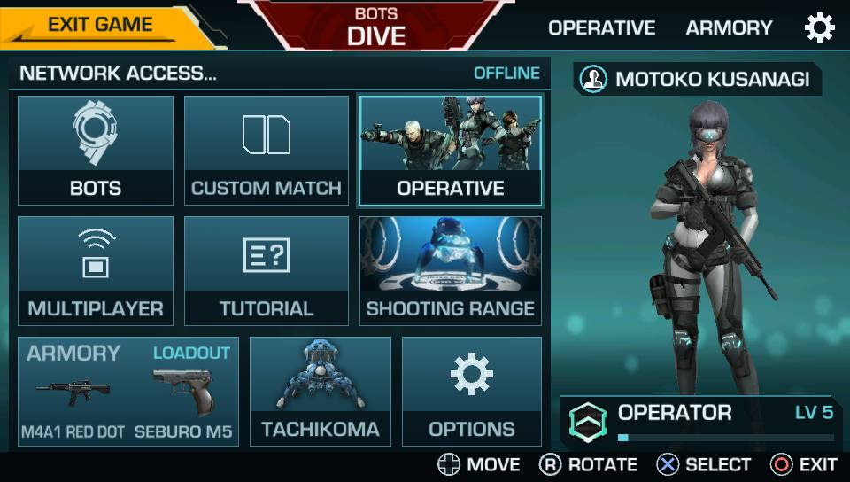
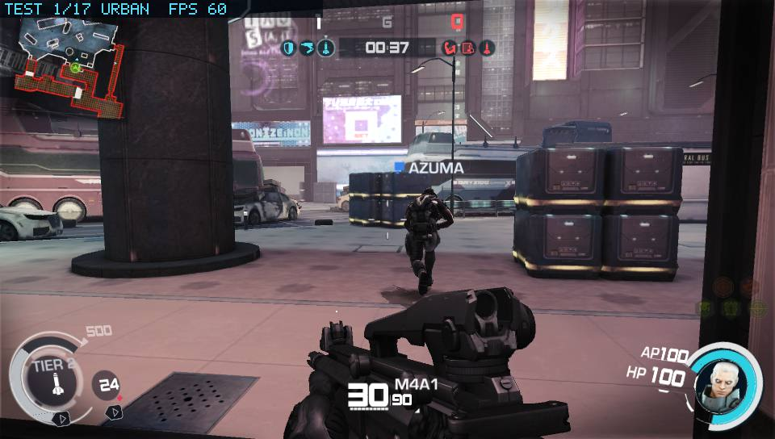
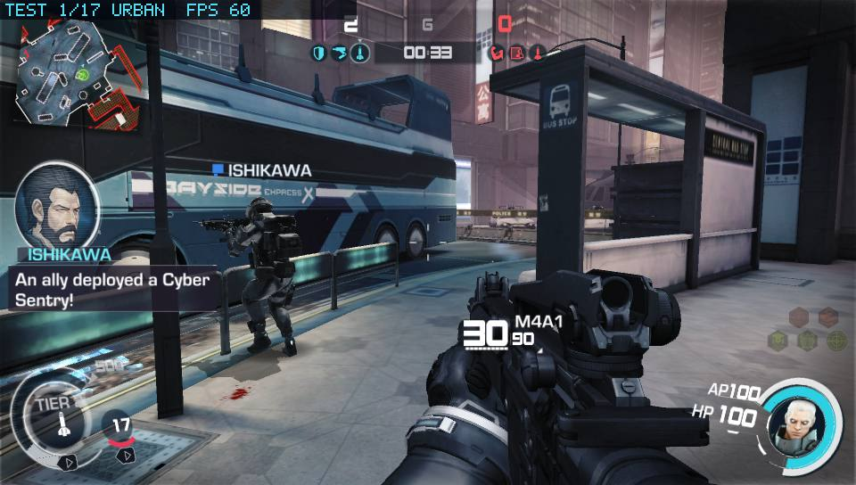
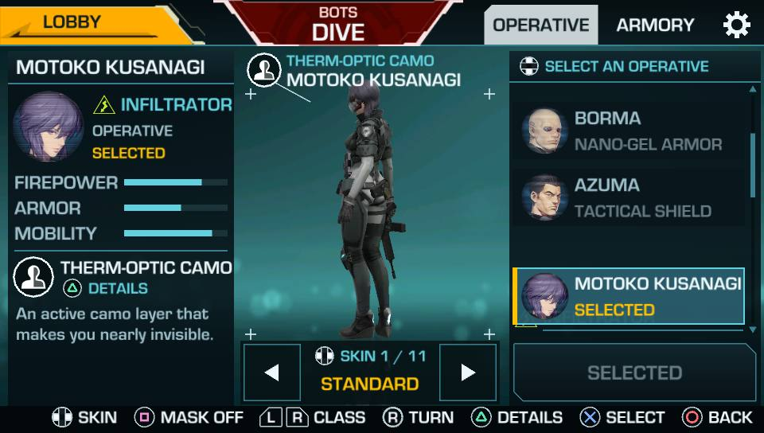
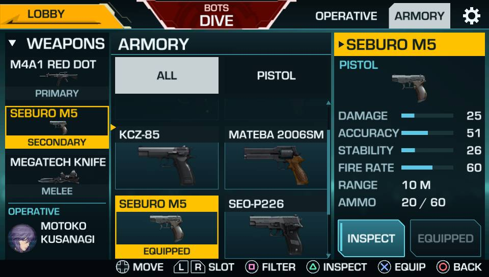
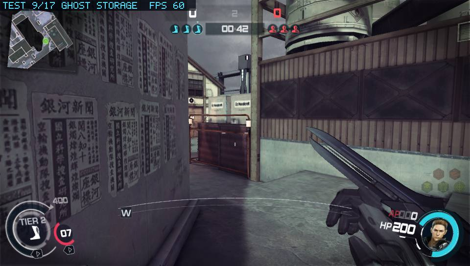

# Ghost in the Shell: First Assault for PS Vita

An unofficial, fan-made PS Vita version of *Ghost in the Shell: Stand Alone Complex - First Assault Online*, the PC
shooter whose servers closed in 2017. It is a new engine written for the Vita (VitaSDK + vitaGL) that plays the game's
content offline, with bots, and with other Vitas over ad-hoc, Wi-Fi or the internet.

**The game's data is not here and is not in the download.** You make it on your own PC from your own copy of the PC
game with the data builder (below). No code of the original game is used: the executable is not opened, patched or run.

This is version **1.0**, the first release. It has been played on one PS Vita. Multiplayer has only been tested with one Vita and
a computer playing the second player, so please expect problems there and report them.

## Screenshots

Taken on a PS Vita (the line at the top left of the match pictures is from the automatic test run, not the normal game).

| | |
|---|---|
|  |  |
| Title screen | Main menu |
|  |  |
| Team Deathmatch on Urban | Team Deathmatch on Urban |
|  |  |
| Operatives | Armory |
|  | |
| Ghost Assault on Ghost Storage | |

## What is in it

- 17 maps: 13 battlefields and the four training rooms (tutorial, shooting range).
- Team Deathmatch, Demolition, Terminal Conquest, Elimination and Ghost Assault, against and alongside bots.
- The 12 operatives with their skills (Tier 1 / Tier 2, SkillSync), outfits and the 50 weapons of the armory.
- The front end: operative, armory, custom match, profile, options; touch works in every menu.
- Multiplayer rooms for up to 8 players: AD-HOC, LAN (same Wi-Fi) and INTERNET with a room code.
- 60 frames a second on most maps.

## What you need

- A PS Vita or PS TV with HENkaku / Ensō and VitaShell.
- `libshacccg.suprx` in `ur0:data/` (the shader compiler every vitaGL game needs; extract it from your own console,
  for example with ShaRKF00D).
- Your own install of the PC game (its `Game Files` folder with `Data\map.dat`, `model.dat`, ...).
- A 64-bit Windows 10 / 11 PC with about 8 GB free for the data builder, and about 900 MB free on the Vita.

## Installing

1. Download from the [latest release](../../releases/latest): `GITSFA-Vita.vpk` and
   `GITSFA-Vita-DataBuilder-win64.zip`.
2. On the PC: unzip the data builder to a short path (for example `C:\GITSFA`), double-click `Build GITS data.bat`
   and drag your install's `Game Files` folder into the window. It takes about an hour (30 to 90 minutes) and only reads your
   install. `README_FIRST.txt` in the zip has the steps; `README.txt` has the details. (The game's intro movie is
   not a video in the install: the builder draws it on your PC from the scene's own files, `tools/intro`.)
3. Copy the `gitsfa` folder it makes to `ux0:data/` on the Vita (so that `ux0:data/gitsfa/hud.ghud` exists).
4. Install `GITSFA-Vita.vpk` with VitaShell and start "GITS First Assault".

If the Vita shows an error when installing or starting after a long session, restart the Vita and try again.

## Controls

| | |
|---|---|
| Left stick / right stick | move / look |
| R / L | fire / aim |
| Cross | jump |
| Circle | crouch (slide while sprinting) |
| Square | reload, pick up, SkillSync |
| Triangle | switch primary / secondary |
| D-pad down | sprint on / off |
| D-pad left | knife (hold: keep it out) |
| D-pad right | tap: Tier 1 skill, hold: Tier 2 |
| D-pad up | grenade (hold to cook, let go to throw) |
| Start | pause menu |
| Select (hold) | scoreboard (Terminal Conquest: call the Tachikoma) |

Menus: D-pad or left stick, Cross to select, Circle to go back, or touch.

## Playing together

Everyone needs **the same release and data made by the same data builder**; a room refuses other builds.

MULTIPLAYER, then Triangle chooses the connection:

- **AD-HOC**: Vitas next to each other, no router.
- **LAN**: Vitas on the same Wi-Fi.
- **INTERNET**: one player hosts. The host's waiting room shows a **ROOM CODE** (`XXXX-XXXX-XXX`) and a line that says
  whether the router opened the port. The others choose INTERNET, press Square (or tap the code box), type the code
  on the Vita's keyboard and join the room that appears.

About internet rooms:

- There is no server: the others connect straight to the host. The room code *is* the host's internet address in
  another form, so give it only to people you would give that to, and do not post it in public.
- The host's router has to let the game in. The game asks it to (UPnP or NAT-PMP). If the waiting room says
  `PORT NOT OPEN`, forward UDP port 47750 to the Vita on the router, or let someone else host.
- A host on a phone hotspot, or with a provider that shares one address among customers
  (`SHARED PROVIDER ADDRESS`), cannot be reached from outside. Someone else has to host.
- The host runs the match: if the host leaves, the room closes.

## Reporting problems

Open an issue here with: what you did, what happened, the map and mode, and the file `ux0:data/gitsfa/boot.log` from
right after it happened (the game writes it on every start). If the Vita wrote a crash dump (`ux0:data/*.psp2dmp`),
mention it.

**Before attaching a log from an internet room, delete the lines that start with `net:`** - they hold your internet
address and room code.

## Known limits

- One real PS Vita has run it. PS TV and other firmware set-ups are untested.
- Internet rooms have not been played between two Vitas yet, and the keyboard for the room code has not been tried on
  hardware.
- Ghost Storage dips below 60 for moments; Urban and Train Station can show a few late frames.
- The operative Ishikawa's menu figure lacks a few loose hair strands the PC shows.
- No accounts, shop, ranks or anything else that needed the game's servers.

## Building from source

- The game: [VitaSDK](https://vitasdk.org) with vitaGL, vitaShaRK and mathneon, then `cd engine && bash build.sh <label>`
  (a `.vpk` in `engine/b/`).
- The data: `python3 tools/databuilder/build_data.py --game "<install>/Game Files" --out <folder>` on Linux, macOS or
  Windows (Python 3.10+, numpy, Pillow, SciPy, etcpak, opencv-python-headless, ffmpeg with libx264, a C/C++ compiler).
- `docs/WIKI_NOTES.md` is the development log: what was measured, tried and decided, build by build.

## Licence

The code in this repository (the engine, the data builder and its converters, the test tools) is free software under
the **GNU General Public License, version 3** - see [LICENSE](LICENSE). You may use, change and share it; if you share
a changed build, you have to share its source under the same licence. It comes with no warranty.

Copyright (C) 2026 the gitsfa-vita authors.

The licence covers this code only:

- Nothing of the game is licensed here. Its content, names and logos belong to their owners (see below), and so do
  the LiveArea pictures in `engine/sce_sys/`, which show the game's key art and logotype.
- `tools/lib/meshopt/` is meshoptimizer (MIT licence, in its header).
- The VPK links vitaGL and vitaShaRK (LGPL-3.0) and math-neon; the data builder's zip carries Python, FFmpeg / x264 and
  the other third-party parts under their own licences, with the licence texts inside.

## Credits and notes

- *Ghost in the Shell: Stand Alone Complex - First Assault Online* was made by Neople and published by Nexon, based on
  the work of Shirow Masamune, Production I.G and Kodansha. This project is not affiliated with or endorsed by any
  of them. All game content belongs to its owners and is not distributed here.
- Built on [VitaSDK](https://vitasdk.org), [vitaGL](https://github.com/Rinnegatamante/vitaGL),
  vitaShaRK and math-neon; the data builder uses Python, numpy, Pillow, SciPy, etcpak, OpenCV, FFmpeg / x264, FriBidi,
  meshoptimizer and the DejaVu fonts (their licences are in the data builder's zip).
- The code was written with Claude (Anthropic's AI model, in Claude Code), directed and tested on a PS Vita by
  the repository's owner.
